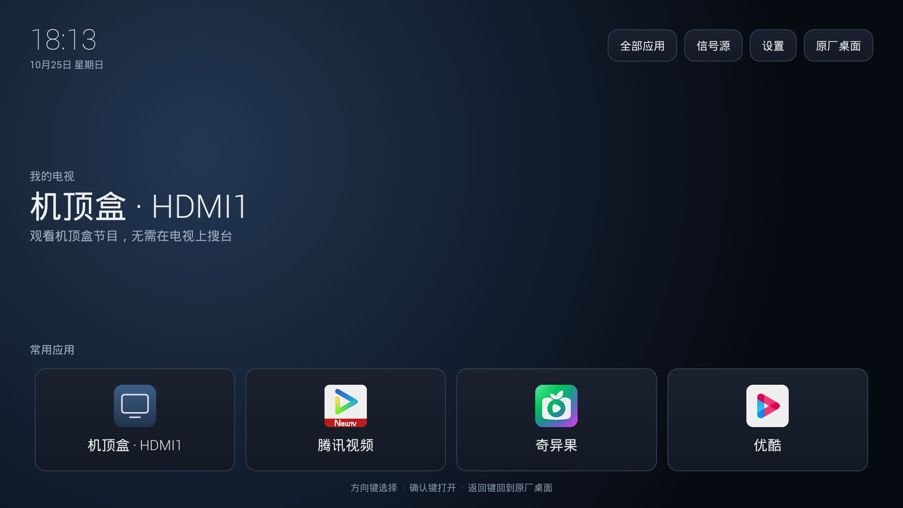

<h1 align="center">TCL 旧电视简洁桌面</h1>

<p align="center"><strong>Android 4.2.1 真机跑通 · 简洁桌面 · 性能诊断与按需精简</strong></p>

<p align="center">
  
  
  
  
</p>

给旧款 TCL 电视增加一个轻量首页，并记录怎样通过实际采样找出拖慢电视的应用、检查退出后的后台残留、按需移除不使用的应用。

**低于 Android 8 也完成了这次改造：本项目已在 Android 4.2.1（API 17）的 TCL MS901 电视上验证。** APK 的最低版本是 API 17；厂商信源、设置和声音处理与固件相关，目前只对下表设备作真机验证。



[下载安装](docs/installation.md) · [提速过程与实测数据](docs/performance.md) · [排错与恢复](docs/troubleshooting.md) · [APK 下载](https://github.com/jsun65214-cloud/tcl-legacy-tv-launcher/releases/latest)

## 两个主要功能

### 1. Android 4.2.1 上的轻量桌面

- 原生 Android 组件与 Java 7 源码，不依赖 AndroidX 或第三方运行库。
- 遥控器方向键、确认键、时钟、应用网格和常用应用入口。
- 保留原厂桌面入口，提供信号源和系统设置入口。
- 机顶盒使用电视原来的 HDMI 输入，不需要在电视上重新搜台。
- 针对已验证 TCL 固件，进入首页时调用原机应用信源接口，解决“画面回桌面了、HDMI 声音还在播放”的问题。
- 桌面不请求联网、录音、存储、无障碍或修改音频设置权限。安装桌面不需要 root。

### 2. 找出卡顿来源，再按需精简

配套只读诊断脚本采集 CPU、内存、安装包、进程与服务。我们实际做了以下工作：

1. 连续采样，而不是仅看“剩余内存”或应用数量。
2. 找出 ATET游戏大厅在卡顿时占用整机约 46%～49% CPU 的现象，并核对联网异常日志。
3. 返回桌面对照复测，再按使用需求移除 ATET游戏大厅、云视听和鲜时光。
4. 在应用的退出对话框里确认退出，检查 Java 主进程、服务和独立原生辅助进程是否留下。
5. 对已移除的云视听，核对进程归属后处理它留下的两个原生进程；保留腾讯视频的低占用辅助进程。

| 本次实测场景 | 整机 CPU 使用率 |
| --- | --- |
| 卡顿期间，游戏大厅处于前台 | 约 55%～58% |
| 返回简洁桌面，应用尚未移除 | 约 6%～9% |
| 按需移除并清理目标残留后，停在桌面 | 约 4%～6% |

这是同一台电视上不同负载状态的短时采样；返回桌面本身已经让 CPU 明显下降。它展示诊断和精简过程，不能将全部差异归因于卸载，也不是跨机型性能保证。**桌面 APK 本身不会自动卸载应用、清理进程或获取 root。**

详见[完整性能案例](docs/performance.md)。

## 已验证设备与边界

| 项目 | 实测结果 |
| --- | --- |
| 产品系列 / 主板 | TCL E5690 / MS901，设备标识 `tcl_901` |
| Android / API | **4.2.1 / 17** |
| 厂商界面 | Smart OS 4.2.9 Plus / MagicCube 5.0 |
| 软件版本 | V8-MS90104-LF1V219 |
| 遥控器、默认 HOME、原厂桌面返回 | 用户实测正常 |
| 外接机顶盒 HDMI1、画面与声音 | 用户实测正常 |
| 回主页后的 HDMI 背景声音 | 已解决，用户实测正常 |
| 进入主页的信源切换 | 约 3 秒短暂等待，仍可优化 |
| 开机广告 | 本次未关闭 |
| 投屏、其他机型、其他系统版本、真正重启后的行为 | 未逐一验证 |

Android 4.2.2 的 API 17 SDK 用于编译；Android 4.3～7.x 或其他品牌不能仅凭最低 API 推断 OEM 入口和声音逻辑兼容。

## 快速使用

需要 Windows PowerShell 5.1+、Google 官方 [Platform Tools](https://developer.android.com/tools/releases/platform-tools)，以及电视上已授权的 ADB 连接。

1. 从 [Releases](https://github.com/jsun65214-cloud/tcl-legacy-tv-launcher/releases/latest) 下载 `legacy-tv-home-1.0.apk` 和 `SHA256SUMS.txt`，核对 SHA-256。
2. 阅读[安装说明](docs/installation.md)，确认自己的设备信息。
3. 在项目目录执行，替换电视地址和文件路径：

```powershell
.\scripts\Install.ps1 -Serial "<电视IP>:5555" -Apk ".\legacy-tv-home-1.0.apk"
```

安装脚本只支持已验证的 MS901/API 17 配置；它会打开预览，默认首页由你在电视的 HOME 选择框中决定。

只读诊断：

```powershell
.\scripts\Inspect.ps1 -Serial "<电视IP>:5555"
```

诊断结果保存在被 Git 忽略的 `.local/diagnostics/`。正常安装和诊断都不会执行高级系统包移除脚本。

## 从源码构建

使用 JDK 8、Android API 17 的 `android.jar`、Windows Build Tools 28.0.3：

```powershell
.\scripts\Build.ps1 -Jdk "<JDK8目录>" `
  -AndroidJar "<SDK目录>\platforms\android-17\android.jar" `
  -BuildTools "<SDK目录>\build-tools\28.0.3"
```

输出到 `build/legacy-tv-home-1.0.apk`，使用适配 API 17 的 v1 签名。默认生成仅保存在 `.local/` 的开发密钥；Release 签名密钥不在仓库内。自编译 APK 与发行 APK 的签名可能不同，更新安装需要使用同一密钥。

## 目录

```text
app/                   原生桌面源码与原创图形资源
scripts/               Windows 构建、安装、恢复和只读诊断
profiles/tcl-ms901/     特定固件的高级预装包移除与恢复脚本
docs/                  安装、故障排查、性能案例与桌面截图
```

高级脚本会改动系统应用位置，只适用于文档中的两个固定目标和已核实的固件。原包保留在设备恢复目录；登录和缓存不属于保证恢复范围。先阅读[机型操作说明](profiles/tcl-ms901/README.md)。

## 项目来源

这次实践受到 [CleanYourTV](https://github.com/Gathin23/cleanyourtv) 的启发。我们为旧系统单独编写了这个原生桌面，没有通过降低其他项目的最低 SDK 来假装兼容；本项目独立维护，也不是 TCL 官方产品。

项目不分发原厂固件、原厂 APK、视频应用安装包、Google SDK 工具或私人设备备份。截图中的视频应用由电视原有安装提供。

原创源码与文档采用 [MIT](LICENSE) 许可证。提交问题时可使用[问题模板](.github/ISSUE_TEMPLATE/bug-report.yml)，提供机型、Android/API、固件和可复现步骤即可。
